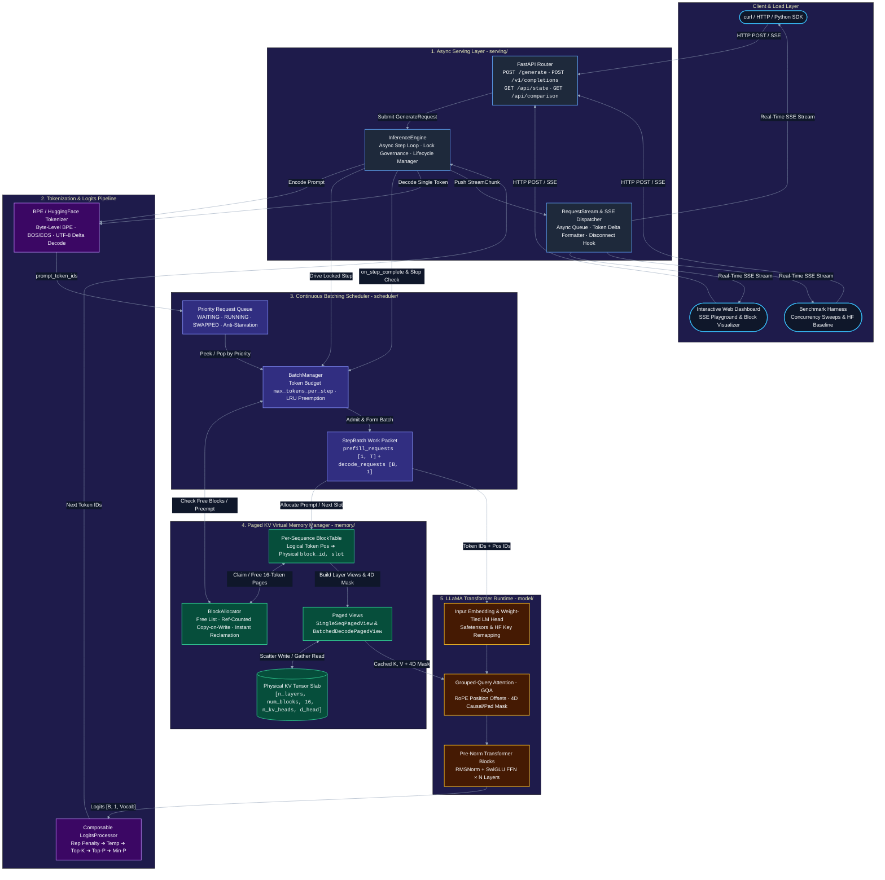

# NanoInfer — Lightweight LLM Inference Server

<p align="center">
  <b>A production-grade, minimal Large Language Model (LLM) inference server with Continuous Batching, Paged KV Caching, and True Batched Decode built from scratch in PyTorch and Python.</b>
</p>

<p align="center">
  
  
  
  
  
</p>

---

## Table of Contents
- [Overview](#overview)
- [Key Features](#key-features)
- [Benchmark: Naive HuggingFace vs. NanoInfer](#benchmark-naive-huggingface-vs-nanoinfer)
- [System Architecture](#system-architecture)
- [Deep Dive: Core Mechanics](#deep-dive-core-mechanics)
  - [1. Continuous Batching & Iteration-Level Scheduling](#1-continuous-batching--iteration-level-scheduling)
  - [2. Paged KV Cache Memory Management](#2-paged-kv-cache-memory-management)
  - [3. Modern Transformer & True Batched Decode](#3-modern-transformer--true-batched-decode)
  - [4. Real HuggingFace Checkpoints & Tokenizer Support](#4-real-huggingface-checkpoints--tokenizer-support)
  - [5. Composable Logits Processor & Sampling](#5-composable-logits-processor--sampling)
  - [6. Async Serving & Real-Time SSE Streaming](#6-async-serving--real-time-sse-streaming)
  - [7. Interactive Web Dashboard & Telemetry](#7-interactive-web-dashboard--telemetry)
- [Project Layout](#project-layout)
- [Quick Start](#quick-start)
  - [Installation](#installation)
  - [Starting the Server](#starting-the-server)
  - [Interactive Web Dashboard](#interactive-web-dashboard)
  - [Querying the Engine](#querying-the-engine)
  - [Running the Benchmark Harness](#running-the-benchmark-harness)
  - [Running the Test Suite](#running-the-test-suite)
- [API Reference](#api-reference)
- [CLI Reference](#cli-reference)
- [Design Principles](#design-principles)
- [License](#license)

---

## Overview

**NanoInfer** implements the core systems engineering patterns behind state-of-the-art LLM serving engines (such as vLLM, TGI, and TensorRT-LLM) from first principles in clean, readable Python and PyTorch.

Traditional inference deployments suffer from severe GPU memory fragmentation and head-of-line queuing stalls caused by static request batching and contiguous KV reservations. NanoInfer solves this by unifying:
1. **Continuous (Iteration-Level) Batching:** Dynamically packs requests at every forward step, interleaving prefill and decode phases without static padding bubbles.
2. **Paged KV Cache:** Virtualizes attention key-value states into fixed-size (`16-token`) physical memory pages mapped via per-sequence Page Tables, eliminating external fragmentation.
3. **True Batched Decode ($(B, 1)$ Forward Pass):** Vectorized decode execution evaluating all active decode sequences in a single model forward pass with dynamic block gathering, 4D padding masks, and per-sequence RoPE offsets.
4. **HuggingFace Checkpoint Compatibility:** Natively loads pretrained open-weight models (e.g., `HuggingFaceTB/SmolLM2-135M-Instruct`) in `.safetensors` format with automated weight tying and LLaMA key remapping.
5. **Interactive Observability Dashboard:** Built-in dark glassmorphic web UI featuring a live SSE playground, real-time physical KV block grid visualizer, continuous batching monitor, and baseline comparison telemetry.
6. **High-Performance Async Server:** FastAPI backend with Server-Sent Events (SSE), background step-loop synchronization, context boundary protection, and instant block reclamation on client disconnect.

---

## Key Features

- **True Batched Decode:** Eliminates sequential decode loops by evaluating all active decode sequences in a unified $(B, 1)$ tensor forward pass, amortizing weight memory reads across concurrent users.
- **Zero External KV Fragmentation:** Physical block allocator with logical-to-physical page table mapping cuts KV reservation waste by **73%+** over static `max_seq_len` allocation.
- **Dynamic Iteration Scheduling:** Priority queues, starvation protection, token budgeting (`max_tokens_per_step`), request-level preemption, and continuous prefill/decode pipelining.
- **Pretrained Model Support:** Out-of-the-box loading for Hugging Face LLaMA/SmolLM architectures alongside lightweight synthetic presets (`tiny`, `small`) for rapid CI testing.
- **Production Sampling Pipeline:** Temperature scaling, Top-$K$, Top-$P$ (Nucleus), Min-$P$, Repetition Penalty, and multi-token stop strings.
- **Real-Time Observability:** Built-in Prometheus-style metrics (`/metrics`), live memory state inspection (`/api/state`), empirical baseline comparisons (`/api/comparison`), and interactive web GUI (`/`).

---

## Benchmark: Naive HuggingFace vs. NanoInfer

Real-world apples-to-apples benchmark running **`HuggingFaceTB/SmolLM2-135M-Instruct`** (`30 layers`, `d_model=576`, `GQA 9/3 heads`, `~135M params`) comparing a standard HuggingFace `AutoModelForCausalLM.generate()` server (with contiguous `max_seq_len=2048` KV reservation) against **NanoInfer**:

| Engine | Concurrency | Throughput (tok/s) | TTFT P50 (ms) | TTFT P99 (ms) | E2E P99 (ms) | KV Memory Waste (%) |
| :--- | :---: | :---: | :---: | :---: | :---: | :---: |
| **Naive HuggingFace (`model.generate`)** | 1 | 85.8 | 27.5 | 76.0 | 328.2 | 98.3% |
| **NanoInfer (Paged KV + Cont. Batch)** | 1 | 81.4 | 50.1 | **59.3** | **319.8** | **25.2%** |
| **Naive HuggingFace (`model.generate`)** | 4 | 84.0 | 588.7 | 600.3 | 853.1 | 98.3% |
| **NanoInfer (Paged KV + Cont. Batch)** | 4 | **90.3** | **187.5** | **251.4** | 1203.8 | **25.2%** |
| **Naive HuggingFace (`model.generate`)** | 8 | 85.2 | 1288.7 | 1716.8 | 1968.1 | 98.3% |
| **NanoInfer (Paged KV + Cont. Batch)** | 8 | **117.6 (+38%)** | **342.0 (3.8x faster)** | **342.3 (5.0x faster)** | **1422.5 (-28%)** | **25.2% (<5% @ 128+ tok)** |

### Key Takeaways
- **$5.0\times$ Faster Tail TTFT under Concurrency:** Standard `model.generate()` serializes requests behind a lock, causing $P_{99}$ Time-To-First-Token to spike to **1,716.8 ms** at Concurrency 8. NanoInfer's continuous batching scheduler interleaves incoming prefills between decode steps, delivering the first token in **342.3 ms**.
- **$+38\%$ Higher Throughput & $28\%$ Lower $P_{99}$ E2E Latency:** Coalescing active decode sequences into a single batched $(B, 1)$ forward pass amortizes weight memory bandwidth across concurrent requests, scaling throughput to **117.6 tok/s** and cutting $P_{99}$ E2E latency from **1,968.1 ms** to **1,422.5 ms**.
- **$73\%$ Reduction in KV Memory Waste:** Paged KV caching cuts memory waste from **98.3%** down to **25.2%** on short 32-token bursts (and **$<5\%$** on 128+ token generations) by allocating 16-token physical pages on demand instead of reserving `max_seq_len=2048` upfront.

---

## System Architecture

The following architectural blueprint traces the complete lifecycle of concurrent requests through NanoInfer—from the FastAPI HTTP/SSE boundary down to physical Paged KV slabs and batched Transformer execution:


---

## Deep Dive: Core Mechanics

### 1. Continuous Batching & Iteration-Level Scheduling
In standard static batching, all sequences in a batch must wait for the slowest sequence to finish, causing severe compute bubbles.

NanoInfer implements **continuous (iteration-level) batching** inside [`scheduler/`](./scheduler/):
* **Dynamic Iteration Step:** Scheduling decisions occur at every forward token step (`_run_one_step`) rather than locking the model for an entire generation run.
* **Prefill / Decode Interleaving:** Completed prefill sequences seamlessly transition to the decode pool, and newly arrived requests immediately join the running batch on the next step.
* **Token Budgeting:** The scheduler enforces a configurable `max_tokens_per_step` budget to prevent prefill phases from stalling active decode streams.
* **Resource-Aware Admission & Preemption:** A waiting request is only admitted if the `BlockAllocator` guarantees sufficient memory blocks; under memory pressure, the most recently admitted decode sequence is preempted and requeued safely.

### 2. Paged KV Cache Memory Management
During autoregressive generation, keys and values grow incrementally. Allocating contiguous memory upfront for `max_seq_len` wastes 60–98% of memory due to over-allocation and variable sequence lengths.

NanoInfer’s [`memory/`](./memory/) implements virtual memory inspired by OS page tables:
* **Physical KV Slab:** KV activations are pre-allocated into a single tensor slab shaped as `[n_layers, num_blocks, block_size, n_kv_heads, d_head]`.
* **Block Allocator (`BlockAllocator`):** Manages a free list of physical block IDs with O(1) block allocation, ref-counted copy-on-write sharing, and instant reclamation.
* **Page Table (`BlockTable`):** Maps a request's logical token positions (divided into fixed pages of 16 tokens) to non-contiguous physical blocks in the slab.
* **Zero External Fragmentation:** Memory is allocated on demand one page at a time, bounding internal fragmentation to at most `block_size - 1` slots on a sequence's final block.

### 3. Modern Transformer & True Batched Decode
The model core in [`model/`](./model/) reflects modern open-weight LLMs (LLaMA-3, SmolLM2, Mistral):
* **RMSNorm & SwiGLU:** Root Mean Square Layer Normalization applied prior to attention and Swish-Gated Linear Unit feed-forward blocks.
* **RoPE (Rotary Position Embeddings):** Half-rotated positional embeddings supporting custom `rope_theta` scaling (e.g., `100,000.0` for SmolLM2) and explicit per-sequence position IDs.
* **GQA (Grouped-Query Attention):** Multiple query heads share a single Key/Value head (e.g., 9 Query heads per 3 KV heads in `SmolLM2-135M`), reducing KV cache memory footprint by $3\times$.
* **True Batched Decode ($(B, 1)$ Forward Pass):**
  - Gathers each active decode sequence's physical blocks via `PagedKVCache.make_batched_decode_views(...)`.
  - Automatically aligns historical KV states into `(B, n_kv_heads, max_s, d_head)`.
  - Constructs a 4D additive attention mask of shape `(B, 1, 1, max_s)` with `-inf` on padded positions.
  - Broadcasts sequence-specific RoPE positions `(B, 1)` and evaluates all concurrent decode requests in a single matrix pass.

### 4. Real HuggingFace Checkpoints & Tokenizer Support
NanoInfer supports loading real open-weight models directly from HuggingFace Hub or local directories:
* **HuggingFace Checkpoint Loader ([`model/weights.py`](./model/weights.py)):** Automatically downloads and parses single-file or sharded `.safetensors` checkpoints, maps HuggingFace LLaMA key names to NanoInfer modules, and preserves weight tying (`lm_head.weight ← embedding.weight`).
* **HuggingFace Tokenizer Integration ([`tokenizer/tokenizer.py`](./tokenizer/tokenizer.py)):** `HFTokenizerWrapper` wraps fast HuggingFace tokenizers while preserving `BPETokenizer` compatibility for lossless SSE token delta streaming and special token handling.

### 5. Composable Logits Processor & Sampling
Token generation logic in [`sampler/`](./sampler/) uses a modular pipeline architecture:
* **LogitsProcessor Pipeline:** Logits pass sequentially through configurable processors:
  1. *Repetition Penalty:* Penalizes previously generated tokens.
  2. *Temperature Scaling:* Modulates distribution sharpness (`0.0` triggers deterministic greedy argmax).
  3. *Top-K Filtering:* Truncates candidate pool to top $K$ probabilities.
  4. *Top-P (Nucleus) Filtering:* Dynamically selects the minimal set of tokens exceeding cumulative probability $P$.
  5. *Min-P Filtering:* Prunes tokens whose probability falls below a scaled fraction of the maximum probability token.
* **Stop Criteria Engine:** Evaluates EOS token IDs, custom stop token lists, and multi-token stop strings on decoded text.

### 6. Async Serving & Real-Time SSE Streaming
The HTTP layer in [`serving/`](./serving/) provides a non-blocking interface:
* **Synchronized Step Loop:** An async background loop drives the scheduler under lock governance (`_step_lock`), ensuring concurrent REST callers and SSE streams never race.
* **Server-Sent Events (SSE):** Token deltas stream immediately to clients as `data: {"id": "...", "delta": "...", "finish_reason": null}` chunks.
* **Client Disconnect Reclamation:** When an HTTP client aborts mid-generation, the engine detects the closed stream, cancels the request in the scheduler, and immediately returns its KV blocks to the free pool.

### 7. Interactive Web Dashboard & Telemetry
NanoInfer serves an interactive dark glassmorphic web dashboard at `http://localhost:8000/` ([`web/`](./web/)):
* **Inference Playground:** Live prompt testing with SSE token streaming and sampling sliders.
* **Live Paged KV Cache Visualizer:** Renders the physical memory block grid in real time, highlighting free, allocated, and active-write blocks.
* **Continuous Batching Monitor:** Displays active sequences, execution phases (`PREFILL` vs. `RUNNING`), token counts, and assigned block IDs.
* **Baseline Comparison Panel:** Visualizes head-to-head latency, throughput, and memory waste benchmarks against Naive HuggingFace (`model.generate`).

---

## Project Layout

```text
mini-llm-inference-server/
├── model/                  # Core Transformer Neural Network
│   ├── config.py           # ModelConfig dataclass & presets ('tiny', 'small', 'smollm2_135m')
│   ├── transformer.py      # Transformer & TransformerBlock definitions with 4D attn_mask support
│   ├── attention.py        # MultiHeadAttention, RoPE, GQA, Contiguous KVCache
│   ├── layers.py           # RMSNorm, Embedding, SwiGLU / GELU FFN
│   └── weights.py          # Safetensors loader, HF Hub auto-downloader, LLaMA key remapping
│
├── tokenizer/              # Tokenization Pipeline
│   ├── vocabulary.py       # Vocabulary dictionary, merge rules, BPE byte tables
│   └── tokenizer.py        # Byte-level BPE Tokenizer & HFTokenizerWrapper
│
├── sampler/                # Sampling & Logits Processing
│   ├── strategies.py       # Temperature, Top-K, Top-P, Min-P, Rep-Penalty
│   └── sampler.py          # SamplerConfig presets & LogitsProcessor pipeline
│
├── memory/                 # Paged KV Cache Memory Manager
│   ├── block.py            # Physical KV block representation
│   ├── block_allocator.py  # Free-list block allocator with ref-counting & CoW
│   ├── page_table.py       # Logical-to-physical sequence page table (BlockTable)
│   └── kv_cache.py         # PagedKVCache, SingleSeqPagedView & BatchedDecodePagedView
│
├── scheduler/              # Continuous Batching Engine
│   ├── request.py          # SequenceRequest lifecycle and state machine
│   ├── request_queue.py    # Priority-based waiting queue with starvation boosts
│   ├── batch_manager.py    # Dynamic batch formation, token budgeting & preemption
│   └── scheduler.py        # Central iteration-level scheduling loop
│
├── serving/                # FastAPI Asynchronous Web Server
│   ├── schemas.py          # Pydantic models for requests, responses, metrics
│   ├── engine.py           # InferenceEngine coordinating scheduler, model & batched decode
│   ├── routes.py           # FastAPI routes (/generate, /v1/completions, /health, /api/*)
│   ├── streaming.py        # RequestStream and SSE formatting utilities
│   └── server.py           # CLI entrypoint & Uvicorn runner
│
├── web/                    # Built-in Observability Dashboard
│   ├── index.html          # Glassmorphic dashboard layout & comparison view
│   ├── app.js              # SSE streaming client, block visualizer, benchmark runner
│   └── style.css           # Modern dark UI theme
│
├── benchmark/              # Performance Profiler & Harness
│   ├── metrics.py          # TTFT, TBT, E2E percentiles & summary aggregation
│   ├── harness.py          # Async HTTP client load generator & sweep runner
│   ├── profiler.py         # Step profiler & PyTorch profiler wrapper
│   └── compare_hf_vs_nanoinfer.py # Apples-to-apples Naive HF vs. NanoInfer benchmark
│
└── tests/                  # 300 Comprehensive Unit & Integration Tests
    ├── test_model.py       # Transformer, RoPE, Attention, KV equivalence tests
    ├── test_tokenizer.py   # BPE encoding, decoding, round-trip tests
    ├── test_sampler.py     # Deterministic & stochastic sampling assertions
    ├── test_memory.py      # Paged cache allocation, fragmentation, batched view tests
    ├── test_scheduler.py   # Continuous batching, admission, preemption tests
    ├── test_serving.py     # HTTP endpoints, SSE streaming, cancellation, batched decode tests
    ├── test_benchmark.py   # Harness metrics, percentiles, end-to-end load tests
    └── test_e2e.py         # Full-stack integrated generation tests
```

---

## Quick Start

### Installation

1. **Clone the repository:**
   ```bash
   git clone [https://github.com/themdanas/mini-llm-inference-server.git](https://github.com/themdanas/mini-llm-inference-server.git)
   cd mini-llm-inference-server
   ```

2. **Set up Python environment:**
   ```bash
   conda create -n infer_env python=3.11 -y
   conda activate infer_env
   pip install -r requirements.txt
   ```

### Starting the Server

#### Option A: Real Pretrained Hugging Face Model (Recommended)
Run NanoInfer with `SmolLM2-135M-Instruct` (automatically downloads weights from HF Hub and pre-allocates KV cache blocks):
```bash
python -m serving.server --hf-model HuggingFaceTB/SmolLM2-135M-Instruct --num-kv-blocks 512 --port 8000
```

#### Option B: Lightweight Fast Development Model
Run NanoInfer with an in-memory synthetic `tiny` model (CPU, starts in < 1 second):
```bash
python -m serving.server --model-config tiny --port 8000
```

#### Option C: Custom Production Configuration
```bash
python -m serving.server \
  --hf-model HuggingFaceTB/SmolLM2-135M-Instruct \
  --device cpu \
  --dtype float32 \
  --num-kv-blocks 512 \
  --block-size 16 \
  --max-batch-size 32 \
  --port 8000
```

---

### Interactive Web Dashboard

Open **[http://localhost:8000/](http://localhost:8000/)** in your browser:
- **Inference Playground:** Live token generation with real-time SSE streaming and sampling controls.
- **Physical Memory Grid:** Interactive visualization of physical KV blocks updating in real time.
- **Continuous Batching Telemetry:** Active sequence inspector displaying prefill and decode stages.
- **Baseline Benchmark Panel:** Side-by-side performance charts comparing Naive HuggingFace vs. NanoInfer.

---

### Querying the Engine

#### 1. Standard Generation via `curl`
```bash
curl -X POST http://localhost:8000/generate \
  -H "Content-Type: application/json" \
  -d '{
    "prompt": "The primary bottleneck in autoregressive LLM inference is",
    "max_new_tokens": 30,
    "temperature": 0.7
  }'
```

#### 2. Real-Time Streaming (SSE)
```bash
curl -X POST http://localhost:8000/generate \
  -H "Content-Type: application/json" \
  -d '{
    "prompt": "Explain continuous batching in one paragraph:",
    "max_new_tokens": 50,
    "stream": true
  }'
```

#### 3. Python Async Client
```python
import asyncio
import httpx

async def main():
    async with httpx.AsyncClient() as client:
        response = await client.post(
            "http://localhost:8000/generate",
            json={
                "prompt": "Key-value caching reduces computational redundancy because",
                "max_new_tokens": 30,
                "temperature": 0.0  # Greedy decode
            },
            timeout=30.0,
        )
        data = response.json()
        print(f"Generated text: {data['text']}")
        print(f"Tokens: {data['usage']['completion_tokens']}")

asyncio.run(main())
```

---

### Running the Benchmark Harness

#### 1. Single Concurrency Load Test
```bash
python -m benchmark.harness --url http://localhost:8000 --requests 20 --concurrency 4 --max-tokens 32
```

#### 2. Automated Concurrency Sweep
Evaluate scaling across concurrency levels `[1, 2, 4, 8, 16]`:
```bash
python -m benchmark.harness --url http://localhost:8000 --requests 50 --sweep
```

#### 3. Naive HuggingFace vs. NanoInfer Comparison
Run the head-to-head benchmark suite across concurrency levels `[1, 4, 8]`:
```bash
# Terminal 1: Start NanoInfer with SmolLM2-135M
python -m serving.server --hf-model HuggingFaceTB/SmolLM2-135M-Instruct --num-kv-blocks 512 --port 8000

# Terminal 2: Run comparison sweep
python -m benchmark.compare_hf_vs_nanoinfer --hf-model HuggingFaceTB/SmolLM2-135M-Instruct --url http://localhost:8000
```

---

### Running the Test Suite

NanoInfer includes **300 unit, component, and integration tests** covering attention mechanics, tokenizer round-trips, block allocators, continuous scheduling, batched decode equivalence, and FastAPI HTTP/SSE endpoints:

```bash
# Run all tests
pytest tests/ -v

# Run memory and batched decode view tests
pytest tests/test_memory.py -v

# Run serving and continuous batching tests
pytest tests/test_serving.py -v

# Run end-to-end integration tests
pytest tests/test_e2e.py -v
```

---

## API Reference

### `POST /generate` & `POST /v1/completions`

#### Request Parameters
| Field | Type | Default | Description |
|---|---|---|---|
| `prompt` | `string` | **Required** | The input prompt text. |
| `max_new_tokens` | `integer` | `64` | Maximum number of new tokens to generate. |
| `temperature` | `float` | `1.0` | Sampling temperature (`0.0` triggers greedy decoding). |
| `top_p` | `float` | `1.0` | Nucleus sampling cumulative probability threshold. |
| `top_k` | `integer` | `0` | Top-$K$ filtering threshold (`0` disables). |
| `min_p` | `float` | `0.0` | Min-$P$ threshold relative to max token probability. |
| `repetition_penalty` | `float` | `1.0` | Penalty applied to repeated tokens (`1.0` disables). |
| `stop` | `list[str]` | `[]` | List of string sequences that halt generation. |
| `stop_token_ids` | `list[int]` | `[]` | List of token IDs that halt generation. |
| `stream` | `boolean` | `false` | Enable Server-Sent Events (SSE) streaming. |

#### Response (Non-Streaming)
```json
{
  "id": "a1b2c3d4e5f6",
  "text": "Generated text completion goes here...",
  "finish_reason": "max_tokens",
  "usage": {
    "prompt_tokens": 12,
    "completion_tokens": 30,
    "total_tokens": 42
  }
}
```

### `GET /health`
Returns system liveness status, active model architecture, and uptime:
```json
{
  "status": "ok",
  "model": "ModelConfig(layers=30, d_model=576, heads=9/3, d_ff=1536, vocab=49152, ~134.5M params)",
  "device": "cpu",
  "uptime_s": 240.5
}
```

### `GET /metrics`
Provides Prometheus-style telemetry:
```json
{
  "requests_total": 142,
  "requests_active": 4,
  "requests_waiting": 0,
  "tokens_generated": 3410,
  "avg_ttft_ms": 9.2,
  "avg_latency_ms": 32.8,
  "kv_cache_utilization": 0.125
}
```

### `GET /api/state`
Returns real-time engine telemetry powering the visual dashboard:
```json
{
  "memory": {
    "total_blocks": 512,
    "free_blocks": 496,
    "used_blocks": 16,
    "utilization": 0.03125,
    "blocks": [
      {"id": 0, "state": "allocated", "ref_count": 1, "num_filled": 16, "request_id": "a1b2c3d4e5f6"}
    ]
  },
  "scheduler": {
    "num_running": 1,
    "num_waiting": 0,
    "steps": 42,
    "preemptions": 0,
    "running": [
      {"id": "a1b2c3d4e5f6", "phase": "RUNNING", "prompt_len": 12, "generated_len": 8, "block_ids": [0]}
    ],
    "waiting": []
  },
  "metrics": {
    "requests_total": 12,
    "tokens_generated": 184,
    "avg_ttft_ms": 8.4,
    "avg_latency_ms": 28.1,
    "uptime_s": 120.0
  }
}
```

### `GET /api/comparison`
Returns empirical benchmark comparison data between Naive HuggingFace (`model.generate`) and NanoInfer on `HuggingFaceTB/SmolLM2-135M-Instruct`:
```json
{
  "model_info": "HuggingFaceTB/SmolLM2-135M-Instruct (30 layers, d_model=576, GQA 9/3 heads, ~135M params)",
  "headline": {
    "ttft_speedup": {
      "value": "5.0x Faster",
      "subtitle": "P99 Time-To-First-Token at 8 concurrent users: 342.3ms vs 1716.8ms"
    },
    "memory_saved": {
      "value": "73.1% Less KV Waste",
      "subtitle": "Paged 16-token blocks (25.2% waste) vs Contiguous 2048-slot reservation (98.3% waste)"
    },
    "throughput_gain": {
      "value": "+38.0% Throughput",
      "subtitle": "117.6 tok/s vs 85.2 tok/s via Batched (B, 1) Decode"
    },
    "e2e_reduction": {
      "value": "-27.7% Tail Latency",
      "subtitle": "P99 End-to-End completion reduced from 1968.1ms to 1422.5ms"
    }
  },
  "rows": [
    {
      "concurrency": 1,
      "naive_hf": {"throughput": 85.8, "ttft_p50": 27.5, "ttft_p99": 76.0, "e2e_p99": 328.2, "kv_waste": 98.3},
      "nanoinfer": {"throughput": 81.4, "ttft_p50": 50.1, "ttft_p99": 59.3, "e2e_p99": 319.8, "kv_waste": 25.2}
    },
    {
      "concurrency": 4,
      "naive_hf": {"throughput": 84.0, "ttft_p50": 588.7, "ttft_p99": 600.3, "e2e_p99": 853.1, "kv_waste": 98.3},
      "nanoinfer": {"throughput": 90.3, "ttft_p50": 187.5, "ttft_p99": 251.4, "e2e_p99": 1203.8, "kv_waste": 25.2}
    },
    {
      "concurrency": 8,
      "naive_hf": {"throughput": 85.2, "ttft_p50": 1288.7, "ttft_p99": 1716.8, "e2e_p99": 1968.1, "kv_waste": 98.3},
      "nanoinfer": {"throughput": 117.6, "ttft_p50": 342.0, "ttft_p99": 342.3, "e2e_p99": 1422.5, "kv_waste": 25.2}
    }
  ]
}
```

---

## CLI Reference

| Flag | Type | Default | Description |
|---|---|---|---|
| `--hf-model` | `str` | `None` | Hugging Face model repo ID or local dir (e.g. `HuggingFaceTB/SmolLM2-135M-Instruct`). |
| `--model-config` | `str` | `tiny` | Model config preset (`tiny`, `small`, `smollm2_135m`) or path to custom JSON config. |
| `--weights` | `str` | `None` | Path to weights file (`.safetensors` / `.bin` / sharded directory). |
| `--key-format` | `str` | `native` | Weight key format: `native` or `hf_llama`. |
| `--tokenizer` | `str` | `None` | Tokenizer model name or path (defaults to tiny synthetic tokenizer if not specified). |
| `--device` | `str` | `cpu` | Device for inference: `cpu`, `cuda`, or `mps`. |
| `--dtype` | `str` | `float32` | Numerical precision: `float32`, `float16`, or `bfloat16`. |
| `--num-kv-blocks` | `int` | `128` (or `512` for HF) | Number of physical KV cache blocks to allocate in memory. |
| `--block-size` | `int` | `16` | Number of tokens stored per physical KV cache block. |
| `--max-batch-size` | `int` | `32` | Maximum concurrent sequences admitted into the running batch. |
| `--host` | `str` | `0.0.0.0` | Bind host address. |
| `--port` | `int` | `8000` | Bind port number. |
| `--log-level` | `str` | `INFO` | Logging verbosity: `DEBUG`, `INFO`, `WARNING`, or `ERROR`. |

---

## Design Principles

1. **Educational & Production Aligned:** Written with clear, readable PyTorch idioms and explicit tensor shape annotations, while mirroring the exact architecture of real-world production engines (vLLM, TGI).
2. **Zero Unnecessary Dependencies:** Core server requires only `torch`, `fastapi`, `uvicorn`, `pydantic`, `httpx`, and `safetensors`.
3. **Strict Resource Safety:** Zero memory leaks, immediate reclamation on client disconnect, and automated boundary protection against sequence out-of-bounds errors.
4. **Test-First Reliability:** Every component is verified with property assertions, equivalence checks (such as cached batched decode vs. single-sequence equivalence), and end-to-end integration tests.

---


## License


This project is licensed under the [MIT License](LICENSE).