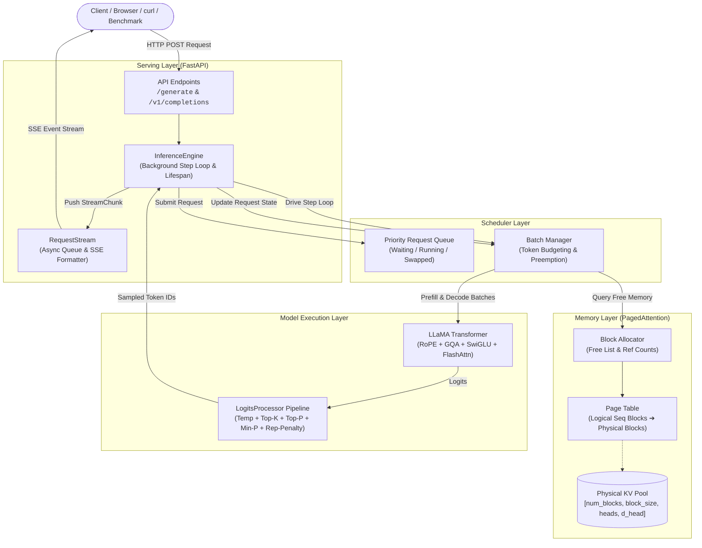

# NanoInfer — Lightweight LLM Inference Server

<p align="center">
  <b>A production-grade, minimal Large Language Model (LLM) inference server with Continuous Batching and Paged KV Caching built from scratch in PyTorch and Python.</b>
</p>

<p align="center">
  
  
  
  
</p>

---

## Table of Contents
- [Overview](#overview)
- [System Architecture](#system-architecture)
- [Deep Dive: Core Mechanics](#deep-dive-core-mechanics)
  - [1. Continuous Batching & Iteration-Level Scheduling](#1-continuous-batching--iteration-level-scheduling)
  - [2. Paged KV Cache Memory Management](#2-paged-kv-cache-memory-management)
  - [3. Modern Transformer Architecture](#3-modern-transformer-architecture)
  - [4. Composable Logits Processor & Sampling](#4-composable-logits-processor--sampling)
  - [5. Async Serving & Real-Time SSE Streaming](#5-async-serving--real-time-sse-streaming)
  - [6. Benchmarking & Observability](#6-benchmarking--observability)
- [Project Layout](#project-layout)
- [Quick Start](#quick-start)
  - [Installation](#installation)
  - [Starting the Server](#starting-the-server)
  - [Querying the Engine](#querying-the-engine)
  - [Running the Benchmark Harness](#running-the-benchmark-harness)
  - [Running the Test Suite](#running-the-test-suite)
- [API Reference](#api-reference)
- [Design Principles](#design-principles)

---

## Overview

**NanoInfer** implements the core engineering patterns behind state-of-the-art LLM serving systems (such as vLLM, TGI, and TensorRT-LLM) in clean, readable Python and PyTorch. 

Traditional inference architectures suffer from severe GPU memory fragmentation and idle compute caused by static request batching. NanoInfer solves this by unifying:
1. **Continuous (Iteration-Level) Batching:** Dynamically packs requests at every forward step, interleaving prefill and decode phases without padding bubbles.
2. **Paged KV Cache:** Virtualizes attention key-value states into fixed-size physical memory pages, eliminating external fragmentation and enabling memory overcommit.
3. **Modern LLaMA-style Attention Engine:** FlashAttention integration (`F.scaled_dot_product_attention`), Rotary Positional Embeddings (RoPE), and Grouped-Query Attention (GQA).
4. **Asynchronous Streaming Server:** FastAPI backend with Server-Sent Events (SSE), background step-loop execution, prompt context limits, and client cancellation handling.
5. **Load Testing & Profiling Harness:** Automated benchmark suite measuring Time-To-First-Token (TTFT), Time-Between-Tokens (TBT), End-To-End (E2E) latency percentiles, and throughput.

---

## System Architecture

The following diagram illustrates the lifecycle of incoming generation requests through NanoInfer:



---

## Deep Dive: Core Mechanics

### 1. Continuous Batching & Iteration-Level Scheduling
In standard static batching, all sequences in a batch must wait for the longest sequence to complete generation, leading to severe GPU under-utilization (the "padding tax").

NanoInfer implements **continuous (iteration-level) batching** inside [`scheduler/`](file:///Users/mdanas/Programming/Projects/NanoInfer/mini-llm-inference-server/scheduler/):
* **Dynamic Iteration Step:** Instead of batching for an entire generation run, scheduling decisions occur at every token forward pass (`_run_one_step`).
* **Prefill / Decode Interleaving:** Completed prefill sequences seamlessly transition to the decode pool, and newly arrived requests immediately join the batch on the next step.
* **Token Budgeting:** The scheduler enforces a configurable `max_tokens_per_step` budget to prevent prefill phases from stalling active decode streams.
* **Resource-Aware Admission:** A waiting request is only admitted into the running batch if the `BlockAllocator` guarantees sufficient memory blocks for its KV cache.

### 2. Paged KV Cache Memory Management
During autoregressive generation, keys and values grow incrementally. Allocating contiguous memory upfront for `max_seq_len` wastes up to 60–80% of memory due to over-allocation and variable sequence lengths.

NanoInfer’s [`memory/`](file:///Users/mdanas/Programming/Projects/NanoInfer/mini-llm-inference-server/memory/) implements virtual memory inspired by OS page tables:
* **Physical KV Cache:** KV activations are pre-allocated into a contiguous memory block pool shaped as `[num_blocks, block_size, n_kv_heads, d_head]`.
* **Block Allocator (`BlockAllocator`):** Manages a free list of physical block IDs. It supports block allocation, ref-counted sharing (for copy-on-write prompt sharing), and instant reclamation.
* **Page Table (`PageTable`):** Maps a request's logical sequence offsets (divided into fixed blocks of 16 tokens) to non-contiguous physical blocks in the pool.
* **Zero External Fragmentation:** Memory is allocated in uniform chunk sizes (e.g., 16 tokens). When a sequence completes, its blocks immediately return to the free list.

### 3. Modern Transformer Architecture
The model core in [`model/`](file:///Users/mdanas/Programming/Projects/NanoInfer/mini-llm-inference-server/model/) reflects modern open-weight LLMs (LLaMA-3, Mistral, Gemma):
* **RMSNorm:** Root Mean Square Layer Normalization applied prior to attention and feed-forward blocks for improved training and inference stability.
* **RoPE (Rotary Position Embeddings):** Applied to Query and Key projections, providing relative position awareness across variable context lengths.
* **GQA (Grouped-Query Attention):** Multiple query heads share a single Key/Value head (e.g. 8 Query heads per 1 KV head), dramatically reducing memory bandwidth demand during autoregressive decoding.
* **SwiGLU FFN:** Swish-Gated Linear Unit activations for enhanced representation capacity over standard GELU/ReLU layers.
* **FlashAttention Support:** Leverages PyTorch's native `torch.nn.functional.scaled_dot_product_attention` for fast kernel execution.
* **Safe Multi-Format Weight Loading:** Compatible with `.safetensors` and `.bin` checkpoints, with automated key remapping for Hugging Face LLaMA checkpoints and sharded weights.

### 4. Composable Logits Processor & Sampling
Token generation logic in [`sampler/`](file:///Users/mdanas/Programming/Projects/NanoInfer/mini-llm-inference-server/sampler/) uses a modular pipeline architecture:
* **LogitsProcessor Pipeline:** Logits pass sequentially through configurable processors:
  1. *Repetition Penalty:* Penalizes previously generated tokens.
  2. *Temperature Scaling:* Modulates distribution sharpness.
  3. *Top-K Filtering:* Truncates candidate pool to top $K$ probabilities.
  4. *Top-P (Nucleus) Filtering:* Dynamically selects the minimal set of tokens exceeding cumulative probability $P$.
  5. *Min-P Filtering:* Prunes tokens whose probability is less than a fraction of the maximum token probability.
* **Stop Criteria Engine:** Evaluates end-of-sequence (EOS) token IDs, custom token lists, and dynamic string patterns (stop strings) directly on decoded text.

### 5. Async Serving & Real-Time SSE Streaming
The HTTP layer in [`serving/`](file:///Users/mdanas/Programming/Projects/NanoInfer/mini-llm-inference-server/serving/) provides an enterprise-ready interface:
* **Background Step Loop:** An asynchronous event loop continuously advances the scheduler, decodes tokens, and dispatches them without blocking HTTP threadpools.
* **Server-Sent Events (SSE):** Token deltas stream immediately to clients as `data: {"id": "...", "delta": "...", "finish_reason": null}` chunks.
* **Client Disconnect Reclamation:** When an HTTP client aborts (e.g., closing a tab or sending `SIGINT`), the engine detects the closed socket, aborts the request, and instantly frees its allocated KV blocks.
* **Context Boundary Protection:** Automatically clamps requested generation lengths against model architecture limits to guarantee out-of-bounds safety.

### 6. Benchmarking & Observability
The [`benchmark/`](file:///Users/mdanas/Programming/Projects/NanoInfer/mini-llm-inference-server/benchmark/) module provides production load-testing tools:
* **Key Metrics Aggregated:**
  * **TTFT (Time to First Token):** Time between request submission and receiving the first generated token (measures prefill latency).
  * **TBT (Time Between Tokens / Inter-Token Latency):** Time elapsed between consecutive generation steps (measures decode speed).
  * **E2E Latency:** Total roundtrip latency from request dispatch to completion.
  * **Throughput:** Effective generation rate in tokens per second across all concurrent streams.
  * **Percentiles:** Exact $P_{50}$, $P_{90}$, and $P_{99}$ latency distributions.
* **Harness Modes:** Supports single load test scenarios and automated concurrency sweeps (`[1, 2, 4, 8, 16]`).

---

## Project Layout

```
mini-llm-inference-server/
├── model/                  # Core Transformer Neural Network
│   ├── config.py           # ModelConfig dataclass & presets ('tiny', 'small')
│   ├── transformer.py      # Transformer & TransformerBlock definitions
│   ├── attention.py        # MultiHeadAttention, RoPE, GQA, FlashAttention
│   ├── layers.py           # RMSNorm, Embedding, SwiGLU / GELU FFN
│   └── weights.py          # Safetensors, PyTorch checkpoints, HF key mapping
│
├── tokenizer/              # Tokenization Pipeline
│   ├── vocabulary.py       # Vocabulary dictionary, merge rules, BPE byte tables
│   └── tokenizer.py        # Byte-level BPE Tokenizer with cache & special tokens
│
├── sampler/                # Sampling & Logits Processing
│   ├── strategies.py       # Temperature, Top-K, Top-P, Min-P, Rep-Penalty
│   └── sampler.py          # SamplerConfig presets & LogitsProcessor pipeline
│
├── memory/                 # Paged KV Cache Memory Manager
│   ├── block.py            # Physical KV block representation
│   ├── block_allocator.py  # Free-list block allocator with ref-counting
│   ├── page_table.py       # Logical-to-physical sequence page table
│   └── kv_cache.py         # PagedKVCache integration layer
│
├── scheduler/              # Continuous Batching Engine
│   ├── request.py          # InferenceRequest lifecycle and sequence state
│   ├── request_queue.py    # Priority-based waiting and running queues
│   ├── batch_manager.py    # Dynamic batch formation and token allocation
│   └── scheduler.py        # Central iteration-level scheduling loop
│
├── serving/                # FastAPI Asynchronous Web Server
│   ├── schemas.py          # Pydantic models for requests, responses, metrics
│   ├── engine.py           # InferenceEngine coordinating scheduler & model
│   ├── routes.py           # FastAPI routes (/generate, /v1/completions, /health)
│   ├── streaming.py        # RequestStream and SSE formatting utilities
│   └── server.py           # CLI entrypoint & Uvicorn runner
│
├── benchmark/              # Performance Profiler & Harness
│   ├── metrics.py          # TTFT, TBT, E2E percentiles & summary aggregation
│   ├── harness.py          # Async HTTP client load generator & sweep runner
│   └── profiler.py         # Step profiler & PyTorch profiler wrapper
│
└── tests/                  # 294 Comprehensive Unit & Integration Tests
    ├── test_model.py       # Transformer, RoPE, Attention, KV equivalence tests
    ├── test_tokenizer.py   # BPE encoding, decoding, round-trip tests
    ├── test_sampler.py     # Deterministic & stochastic sampling assertions
    ├── test_memory.py      # Paged cache allocation, fragmentation, leak tests
    ├── test_scheduler.py   # Continuous batching, admission, preemption tests
    ├── test_serving.py     # HTTP endpoints, SSE streaming, cancellation tests
    ├── test_benchmark.py   # Harness metrics, percentiles, end-to-end load tests
    └── test_e2e.py         # Full-stack integrated generation tests
```

---

## Quick Start

### Installation

1. **Clone the repository:**
   ```bash
   git clone https://github.com/themdanas/mini-llm-inference-server.git
   cd mini-llm-inference-server
   ```

2. **Set up Python environment:**
   ```bash
   conda create -n infer_env python=3.11 -y
   conda activate infer_env
   pip install -r requirements.txt
   ```

### Starting the Server

Run the server with default settings (in-memory tiny model, CPU, port 8000):
```bash
python -m serving.server
```

**Custom configuration options:**
```bash
python -m serving.server \
  --host 0.0.0.0 \
  --port 8000 \
  --device cpu \
  --model-config tiny \
  --num-kv-blocks 128 \
  --block-size 16 \
  --max-batch-size 32
```

### Querying the Engine

#### 1. Interactive Swagger UI
Open **[http://localhost:8000/docs](http://localhost:8000/docs)** in your browser to inspect schemas and send requests interactively.

#### 2. Standard Generation via `curl`
```bash
curl -X POST http://localhost:8000/generate \
  -H "Content-Type: application/json" \
  -d '{
    "prompt": "The future of artificial intelligence is",
    "max_new_tokens": 30,
    "temperature": 0.8
  }'
```

#### 3. Real-Time Streaming (SSE)
```bash
curl -X POST http://localhost:8000/generate \
  -H "Content-Type: application/json" \
  -d '{
    "prompt": "Explain quantum computing in one sentence:",
    "max_new_tokens": 40,
    "stream": true
  }'
```

#### 4. Python Async Client
```python
import httpx
import asyncio

async def generate():
    async with httpx.AsyncClient() as client:
        response = await client.post(
            "http://localhost:8000/generate",
            json={
                "prompt": "Deep learning architectures",
                "max_new_tokens": 25,
                "temperature": 0.7
            }
        )
        print(response.json())

asyncio.run(generate())
```

---

### Running the Benchmark Harness

The benchmark harness tests generation throughput and latency percentiles under concurrent load:

#### Single Concurrency Run
```bash
python -m benchmark.harness --url http://localhost:8000 --requests 20 --concurrency 4 --max-tokens 32
```

**Example output:**
```
========================================================
  Benchmark Results
========================================================
  Requests        : 20  (20 ok, 0 failed)
  Concurrency     : 4
  Wall time       : 0.14s

  Throughput      : 2210.4 tok/s
  Total tokens    : 310

  TTFT (ms)         p50=8.4   p90=10.2  p99=12.1
  TBT  (ms)         p50=0.8   p90=1.1   p99=1.5
  E2E  (ms)         p50=24.5  p90=42.1  p99=46.3

  Avg prompt len  : 6.2 tokens
  Avg output len  : 15.5 tokens
========================================================
```

#### Concurrency Sweep
Evaluate scaling across concurrency levels `[1, 2, 4, 8, 16]`:
```bash
python -m benchmark.harness --url http://localhost:8000 --requests 50 --sweep
```

---

### Running the Test Suite

NanoInfer includes **294 comprehensive unit, component, and integration tests**:

```bash
# Run all tests
pytest tests/

# Run benchmark module tests with verbose output
pytest tests/test_benchmark.py -v

# Run memory allocation tests
pytest tests/test_memory.py -v
```

---

## API Reference

### `POST /generate` & `POST /v1/completions`

#### Request Body
| Field | Type | Default | Description |
|---|---|---|---|
| `prompt` | `string` | **Required** | The input prompt text. |
| `max_new_tokens` | `integer` | `64` | Maximum number of new tokens to generate. |
| `temperature` | `float` | `1.0` | Sampling temperature. `0.0` triggers greedy decoding. |
| `top_p` | `float` | `1.0` | Nucleus sampling cumulative probability threshold. |
| `top_k` | `integer` | `0` | Top-$K$ filtering threshold (`0` disables). |
| `min_p` | `float` | `0.0` | Min-$P$ threshold relative to max token probability. |
| `repetition_penalty` | `float` | `1.0` | Penalty applied to repeated tokens (`1.0` disables). |
| `stop` | `list[str]` | `[]` | List of string sequences that halt generation. |
| `stop_token_ids` | `list[int]` | `[]` | List of token IDs that halt generation. |
| `stream` | `boolean` | `false` | Enable Server-Sent Events (SSE) streaming. |

#### Response (Non-Streaming)
```json
{
  "id": "a1b2c3d4e5f6",
  "text": "Generated text completion goes here...",
  "finish_reason": "max_tokens",
  "usage": {
    "prompt_tokens": 12,
    "completion_tokens": 30,
    "total_tokens": 42
  }
}
```

### `GET /health`
Returns system liveness status, active model architecture, and uptime:
```json
{
  "status": "ok",
  "model": "ModelConfig(layers=2, d_model=64, heads=4/4, d_ff=256, vocab=515, ~164.4K params)",
  "device": "cpu",
  "uptime_s": 240.5
}
```

### `GET /metrics`
Provides Prometheus-style telemetry:
```json
{
  "requests_total": 142,
  "requests_active": 4,
  "requests_waiting": 0,
  "tokens_generated": 3410,
  "avg_ttft_ms": 9.2,
  "avg_latency_ms": 32.8,
  "kv_cache_utilization": 0.125
}
```

---

## Design Principles

1. **Educational & Production Aligned:** Written with clear, readable PyTorch idioms and explicit tensor shape annotations, while mirroring the exact architecture of real-world production engines.
2. **Zero Unnecessary Dependencies:** Core server requires only `torch`, `fastapi`, `uvicorn`, `pydantic`, `httpx`, and `safetensors`.
3. **Strict Resource Safety:** Zero memory leaks, immediate reclamation on client disconnect, and automated boundary protection against sequence out-of-bounds errors.
4. **Test-First Reliability:** Every component is verified with property assertions, equivalence checks (such as cached decode vs full prefill equivalence), and end-to-end integration tests.

---

## License

This project is licensed under the [MIT License](LICENSE).